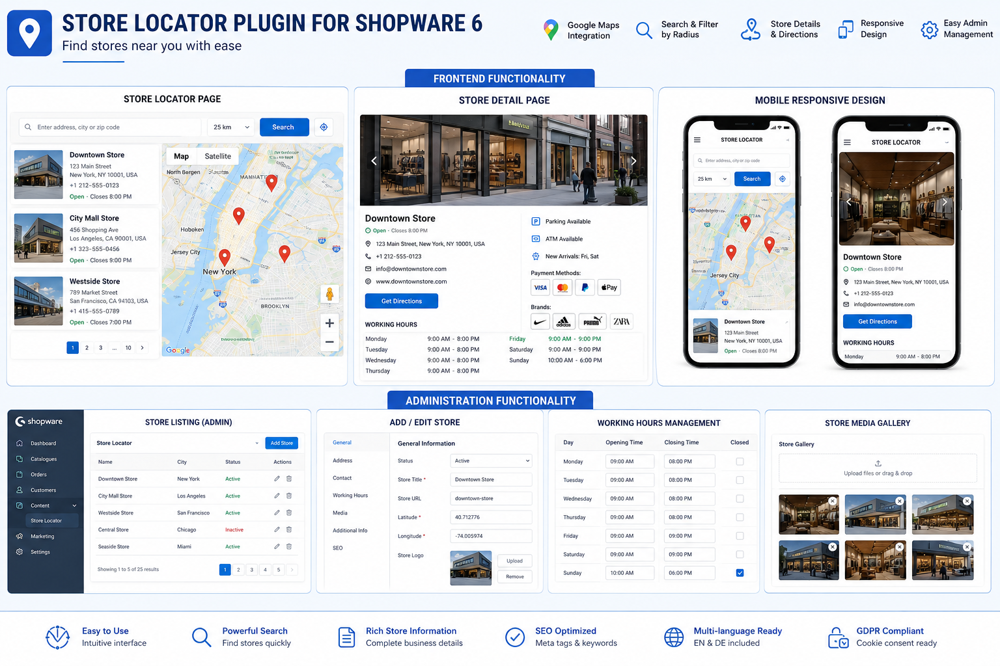

# Store Locator Plugin for Shopware 6

<p align="left">
  
  
  
  
  
  
</p>

A professional, feature-rich Store Locator plugin for Shopware 6 with Google Maps integration, enabling customers to easily find physical store locations.

## Features




### Core Functionality
- **Interactive Google Maps Integration** - Display all store locations on an interactive map
- **Location Search** - Search stores by address, city, or current location
- **Radius-Based Filtering** - Find stores within a specific distance (kilometers or miles)
- **Store Detail Pages** - Dedicated pages for each store with complete information
- **Responsive Design** - Fully responsive and mobile-friendly interface

### Store Management
- **Complete Store Information**
  - Store name, address, city, state, country, postal code
  - Contact details (phone, email, website)
  - Geographic coordinates (latitude/longitude)
  - Store logo/icon
  - Rich text description
  - Image gallery for each store

- **Working Hours Management**
  - Configure opening hours for each day of the week
  - Display current day's hours prominently
  - Show full weekly schedule

- **Advanced Store Features**
  - Parking availability indicator
  - ATM availability indicator
  - New arrivals schedule (specific days)
  - Supported payment methods
  - Available brands/manufacturers
  - SEO meta tags (title, description, keywords)

### Administration Features
- **Intuitive Admin Interface** - Easy-to-use administration panel in Shopware backend
- **Store CRUD Operations** - Create, read, update, and delete stores
- **Media Management** - Upload and manage store logos and gallery images
- **Bulk Management** - Manage multiple stores efficiently
- **Validation** - Built-in validation for coordinates and required fields

### Frontend Features
- **Store Listing Page** - Paginated list of all active stores
- **Interactive Map** - Click on map markers to view store details
- **Store Cards** - Information-rich store cards with quick access to details
- **Search & Filter** - Real-time search and radius-based filtering
- **Get Directions** - Direct link to Google Maps for navigation
- **Cookie Consent** - GDPR-compliant Google Maps cookie handling

### Configuration Options
- **Google Maps API Token** - Configure your Google Maps API key
- **Display Limit** - Set number of stores per page
- **Map Zoom Level** - Configure default map zoom
- **Distance Units** - Choose between kilometers or miles
- **Header Icon** - Optional store locator icon in header
- **Detail Page Toggle** - Enable/disable individual store detail pages

## Requirements

- Shopware 6.5.0 or higher
- PHP 8.0 or higher
- Google Maps API key (with Maps JavaScript API enabled)

## Installation

### Via Composer (Recommended)
```bash
composer require storelocator/store-locator-plugin
bin/console plugin:refresh
bin/console plugin:install --activate StoreLocatorPlugin
bin/console cache:clear
```

### Manual Installation
1. Download the plugin
2. Extract to `custom/plugins/StoreLocatorPlugin`
3. Run the following commands:
```bash
bin/console plugin:refresh
bin/console plugin:install --activate StoreLocatorPlugin
bin/console cache:clear
```

### Build Administration Assets
```bash
bin/build-administration.sh
```

### Build Storefront Assets
```bash
bin/build-storefront.sh
```

## Configuration

### 1. Google Maps API Setup
1. Go to [Google Cloud Console](https://console.cloud.google.com/)
2. Create a new project or select existing one
3. Enable "Maps JavaScript API"
4. Create API credentials (API Key)
5. Restrict the API key to your domain (recommended)

### 2. Plugin Configuration
Navigate to: **Settings → System → Plugins → Store Locator**

Configure the following options:
- **Google API Token**: Enter your Google Maps API key
- **Limit**: Number of stores to display per page (default: 5)
- **Zoom**: Default map zoom level (default: 10)
- **Distance Units**: Choose km or miles
- **Add Icon in Header**: Show/hide store locator icon in header
- **Enable Detail Page**: Enable/disable individual store detail pages

## Usage

### Adding a Store

1. Navigate to **Content → Store Locator** in the administration
2. Click "Add New Store"
3. Fill in the required information:
   - **General Tab**:
     - Status (Active/Inactive)
     - Store Title
     - Latitude and Longitude
     - Store URL
     - Store Logo
   
   - **Address Tab**:
     - Country
     - State/Province
     - City
     - Postal Code
     - Street Address
   
   - **Contact Tab**:
     - Phone Number
     - Email Address
   
   - **Working Hours Tab**:
     - Configure opening hours for each day
   
   - **Media Tab**:
     - Upload store images for gallery
   
   - **Additional Information**:
     - Parking availability
     - ATM availability
     - New arrivals days
     - Payment methods
     - Brands/Manufacturers
     - Description
     - SEO meta tags

4. Click "Save"

### Frontend Access

Customers can access the store locator at:
```
https://your-domain.com/stores
```

### Embedding in Navigation

Add a link to `/stores` in your navigation menu through:
**Content → Shopping Experiences → Navigation**

## Database Schema

### Tables Created

#### `store_locator`
Main table storing store information:
- id, active, title, url, address, city, state, country
- postal_code, number, email, latitude, longitude
- logo, working_hours, description
- parking_available, atm, new_arrivals
- payment_method, manufacturer
- meta_title, meta_description, seo_keywords
- created_at, updated_at

#### `store_locator_media`
Table for store image galleries:
- id, position, store_id, media_id
- created_at, updated_at

## API Endpoints

### Frontend Routes

- `GET /stores` - Display store locator page
- `POST /stores/ajax` - Load stores via AJAX (pagination)
- `POST /stores/search` - Search stores by location and radius
- `POST /stores/detail` - Display individual store detail page

## Customization

### Template Override

Override templates by creating files in your theme:
```
YourTheme/
└── views/
    └── storefront/
        └── page/
            ├── stores.html.twig
            └── store-detail.html.twig
```

### Styling

Override styles in your theme's SCSS:
```scss
// Custom store locator styles
.store_locator_main {
    // Your custom styles
}
```

### JavaScript Customization

The plugin registers two JavaScript plugins:
- `StoreLocator` - Main store listing functionality
- `StoreLocatorDetail` - Store detail page functionality

## Troubleshooting

### Map Not Displaying
- Verify Google Maps API key is correct
- Ensure Maps JavaScript API is enabled in Google Cloud Console
- Check browser console for API errors
- Verify cookie consent is given

### Stores Not Showing
- Ensure stores are marked as "Active"
- Verify latitude/longitude coordinates are correct
- Check that stores are within search radius
- Clear Shopware cache: `bin/console cache:clear`

### Administration Not Loading
- Rebuild administration: `bin/build-administration.sh`
- Clear browser cache
- Check browser console for JavaScript errors

## Performance Optimization

- Enable HTTP/2 for faster asset loading
- Use CDN for Google Maps API
- Implement lazy loading for store images
- Enable Shopware HTTP cache
- Optimize database queries with proper indexing

## Security

- API keys should be restricted to your domain
- Input validation on all form fields
- SQL injection protection via Doctrine DBAL
- XSS protection via Twig auto-escaping
- CSRF protection on all forms

## Browser Support

- Chrome (latest)
- Firefox (latest)
- Safari (latest)
- Edge (latest)
- Mobile browsers (iOS Safari, Chrome Mobile)

## Changelog

### Version 1.0.1
- Initial release
- Google Maps integration
- Store CRUD operations
- Radius-based search
- Working hours management
- Store detail pages
- Image gallery support
- Multi-language support (EN, DE)
- SEO optimization
- Cookie consent handling

## Support

For support, please contact:
- Email: priyanshujoshi2252@gmail.com

## License

Proprietary - All rights reserved

## Credits

Developed for Shopware 6 e-commerce platform.

---

**Note**: This plugin requires a valid Google Maps API key. Google Maps usage may incur costs based on your usage. Please review [Google Maps Pricing](https://cloud.google.com/maps-platform/pricing) for details.
